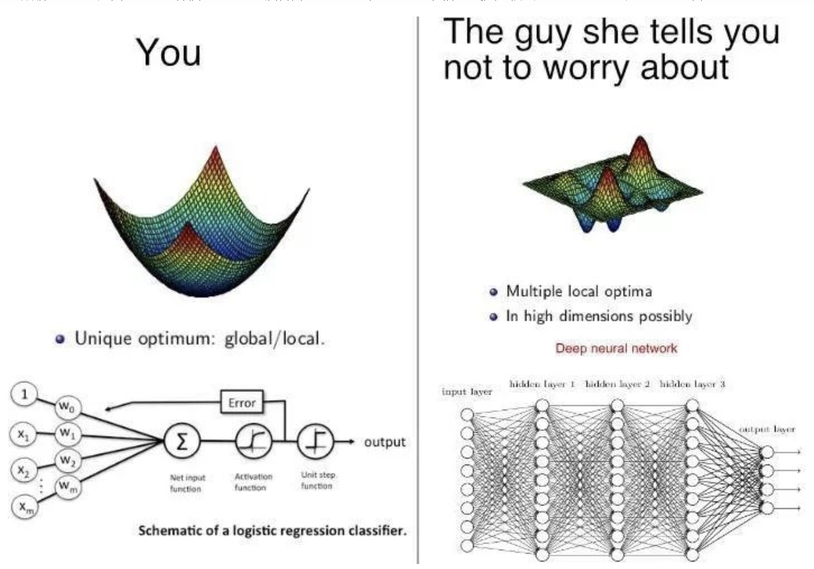

### 核心问题：什么是“可解释性”？
### 为什么黑盒模型（深度学习）在监管面前容易碰壁？
### 在什么场景下（比如图像识别、海量文本），必须用深度学习？

这是一张机器学习领域的经典梗图，套用了「你 vs 她让你别担心的人」的流行对比模板，用非常形象的方式调侃了**逻辑回归**和**深度神经网络**在模型复杂度、优化难度上的巨大差距。

### 左边：You（你）—— 逻辑回归
左侧代表简单、朴素的经典机器学习模型「逻辑回归分类器」，对应梗里“平平无奇的你”。

1.  **上方的损失函数曲面**
    图中是一个光滑的“碗状”凸函数，配文 *Unique optimum: global/local*（唯一最优解：全局最优=局部最优）。
    这是逻辑回归的核心特点：它的损失函数是**凸优化问题**，损失曲面只有一个最低点，用梯度下降等优化算法一定能找到全局最优解，不存在“陷入局部最优”的困扰，优化过程简单、稳定。

2.  **下方的模型结构**
    这是逻辑回归分类器的原理图：
    - 输入是多个特征 \(x_1,x_2...x_m\)，加上偏置项，经过加权求和（净输入）、激活函数、阶跃函数，最终输出分类结果；
    - 本质是**单层线性模型**，没有隐藏层，结构非常简单，参数少，可解释性强。

---

### 右边：The guy she tells you not to worry about —— 深度神经网络
右侧代表复杂强大的深度神经网络，对应梗里“让你有危机感的对手”。

1.  **上方的损失函数曲面**
    图中是高低起伏、布满山峰山谷的复杂曲面，配文 *Multiple local optima*（大量局部最优解）、*In high dimensions possibly*（在高维空间中更是如此）。
    深度神经网络的损失函数是**非凸的**：参数空间里存在无数个局部最低点，训练时很容易陷入局部最优而非全局最优；再加上高维参数空间的特性，优化地形远比逻辑回归复杂，训练难度、调参难度都指数级上升。

2.  **下方的模型结构**
    这是深层全连接神经网络的示意图：
    - 包含输入层、3层隐藏层、输出层，每层有大量神经元，层与层之间全连接；
    - 属于**深层非线性模型**，参数量巨大，能拟合极其复杂的数据模式，能力远强于逻辑回归，但也更难训练、更难解释。

---

### 梗的笑点与内涵
这张图用恋爱焦虑的梗做类比，精准戳中了机器学习从业者的共鸣：
- 逻辑回归简单、稳妥、一目了然，像“朴素的你”；
- 深度神经网络结构复杂、能力强大、充满未知与挑战，像那个“更有魅力的对手”。

它同时也精准概括了两类模型的核心差异：**凸优化 vs 非凸优化**、**浅层线性模型 vs 深层非线性模型**，是技术梗里既好笑又准确的典型。

这份笔记模拟了你作为信用管理专业学生，在查阅资料并结合之前看的“华为 JD”后，写出的 GitHub 学习笔记。

你可以直接参考、修改并保存为 `reading_notes/day3_传统模型与深度学习.md`，提交到你的仓库。

***

# 传统机器学习 vs 深度学习：为什么银行偏爱逻辑回归？

> **日期**：2026-10-28
> **核心问题**：弄明白为什么银行喜欢逻辑回归，而华为 JD 里要招懂 PyTorch 的人？什么是“可解释性”？

## 一、 核心概念对比

| 维度 | 逻辑回归（传统机器学习） | 神经网络 / 深度学习 |
| :--- | :--- | :--- |
| **结构** | 简单的线性模型，数学公式一目了然。 | 多层网络结构，包含大量神经元和复杂参数。 |
| **擅长数据** | 结构化数据（Excel表格、数据库里的数字、类别）。 | 非结构化数据（图像、语音、大段无规则的文本）。 |
| **核心优势** | **极强的可解释性**、模型稳定、算力要求低。 | **强大的非线性拟合能力**、能自动提取复杂特征。 |
| **致命弱点** | 无法处理高度复杂的非线性关系。 | 黑盒模型（无法解释），容易过拟合，需要海量数据和算力。 |

## 二、 深入剖析：什么是“可解释性”？为什么监管碰壁？

**1. 什么是可解释性？**
就是“我不仅要知道你拒绝了这笔贷款本身，我还必须知道**为什么**拒绝”。
逻辑回归的每个特征都有一个“权重（系数）”。如果模型拒绝了客户张三，我可以直接拿出公式说：“**因为你负债率过高（扣了30分），且近3个月查询次数过多（扣了20分），所以你的总分低于及格线。**”

**2. 为什么黑盒模型在金融监管面前容易碰壁？**
神经网络（深度学习）就像是一个黑盒。当你把张三的数据喂进去，模型输出了“拒绝”。如果你问模型为什么，模型内部的几百层神经元根本无法给你一个人类能听懂的解释。
在金融行业（如《巴塞尔协议III》要求），银行必须向客户和监管机构证明，其风控决策是**公平、非歧视且逻辑自洽的**。如果用黑盒模型拒绝了客户，银行无法向监管局解释拒贷理由，甚至会引发法律诉讼。因此，可解释性是传统金融机构的“生命线”。

## 三、 场景分析：华为 JD 为什么要招懂 PyTorch 的人？

结合我之前看到的那份华为风控算法 JD，虽然传统信贷审批爱用逻辑回归，但现代风控面临了更复杂的挑战：
1. **反欺诈与团伙挖掘**：欺诈分子往往不是单兵作战，而是形成复杂的网络。用图神经网络（GNN）分析“设备-账号-IP”的关联，比逻辑回归强得多。
2. **多模态数据处理**：比如分析客户上传的证件照片是否伪造（CV），或者分析客服催收的录音情绪（NLP）。
3. **海量高维数据**：互联网平台（如华为、美团）的数据维度极高，深度学习更能捕捉变量间复杂的隐形交互。

**结论**：逻辑回归用于处理“稳定、结构化”的信用评估；深度学习（PyTorch）用于处理“海量、非结构化、复杂网络”的欺诈和探索性任务。两者在工业界是互补的。

---
## 💡 300字总结：为什么传统风控爱用LR？

传统风控领域（尤其是银行、消金公司）极度偏爱逻辑回归（LR），核心原因在于**“业务解释性”和“监管合规”**。首先，LR 的数学本质决定了它具备透明的打分机制，每一个变量的权重都能转化为直观的业务解释（例如：高负债扣多少分），这让业务人员能够精准制定风控策略，也满足监管对“拒贷理由可解释”的硬性要求。
其次，LR 配合特征工程（如 WOE 分箱转换），能极其稳定地处理结构化数据，且对算力要求极低。相比之下，复杂的深度学习模型虽然预测精度可能略高，但其“黑盒”特性使得决策过程难以追溯。在风控这种“防范灾难性损失”重于“追求绝对精度”的行业，LR 的稳定性和透明度，是花哨的黑盒模型无法替代的。

***